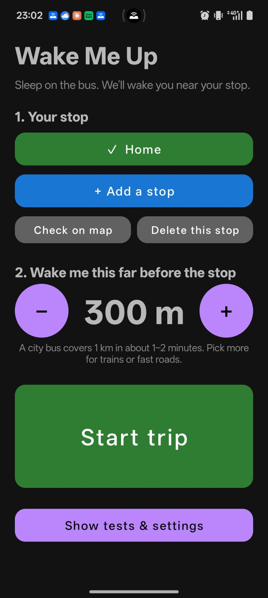
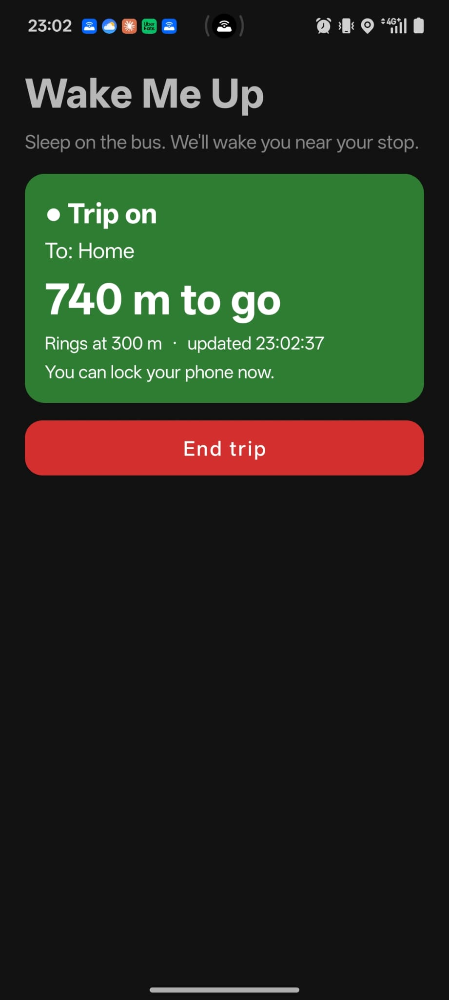

# Wake Me Up

A free Android app that wakes you up before your bus or train stop.

You save the stop where you get off, pick a distance, and tap **Start trip**. The app watches
your position with GPS and rings a loud alarm when you are that close to your stop. You can
lock the phone and sleep.

<p>
  
  
</p>

No account, no ads, no cost. Not affiliated with Google.

## How to use it

1. **Add your stop.** Three ways:
   - In Google Maps, press and hold on the stop to drop a pin, tap **Share**, and choose
     **Wake Me Up**. (Easiest and most exact.)
   - Type the stop name or address in the app.
   - Tap **Save where I am right now** while standing at the stop.
2. **Pick a distance**, from 300 m to 3 km. A city bus covers 1 km in roughly 1–2 minutes.
3. Tap **Start trip** and lock the phone.
4. The alarm rings and vibrates when you are inside that distance. Tap **STOP ALARM**.

The trip switches itself off after the alarm, or after 3 hours.

## Tested so far

This is an early version made by a beginner, with help from an AI assistant. Be honest with
yourself about how much you trust it: **set a normal alarm as a backup.**

What has really been tested, all on one phone (OnePlus Nord CE5 Lite, Android 16):

- The alarm sound, vibration and STOP button.
- The built-in desk test (a pretend trip that counts down and rings).
- Saving a stop by sharing it from Google Maps (one place).
- One real trip to a saved stop, with the alarm set to 300 m. It rang.

Not tested yet:

- Long rides with the screen off.
- Other phone brands and other Android versions.
- Trains, tunnels, and places with weak GPS.
- Every kind of place you can share from Google Maps.

## Install without building

1. Open the [Releases](../../releases) page of this repository on your Android phone.
2. Download the `.apk` file from the newest release.
3. Open the downloaded file. Android will ask you to allow installing from your browser or
   file app: allow it, then tap **Install**.
4. If Google Play Protect warns that it does not know the app, that is because the app is not
   on the Play Store. You can choose to install anyway.
5. Open **Wake Me Up** and allow **Location** (choose **Precise** and **While using the app**)
   and **Notifications**.

The release file is a debug build, which means it is signed with a test key. If a later
version is signed differently, you will need to uninstall the old one before installing it.

## Build it yourself with Android Studio

1. Install [Android Studio](https://developer.android.com/studio).
2. Download this repository (green **Code** button, then **Download ZIP**, and unzip it), or
   clone it with git.
3. In Android Studio choose **File > Open** and pick the project folder.
4. Wait for the first sync to finish. It downloads what it needs and can take several minutes.
5. Connect your phone with a USB cable, with **USB debugging** switched on in the phone's
   Developer options, and press the green **Run** button.

Or from a terminal in the project folder:

```
gradlew.bat assembleDebug
```

(on macOS or Linux: `./gradlew assembleDebug`). The app file appears at
`app/build/outputs/apk/debug/app-debug.apk`.

Needs Android 8.0 or newer on the phone.

## Battery settings (important on OnePlus, Xiaomi, Oppo, Realme, Huawei, Samsung)

Some phones stop apps that run with the screen off, which would stop the alarm. Before a real
ride:

1. In the app, tap **Show tests & settings**, then **App info (battery: allow background)**.
2. Open the battery section and choose **Allow background activity** (or "Unrestricted" /
   "No restrictions", depending on the phone).

## Privacy

- Your location is used only while a trip is on. It stays on the phone. It is never uploaded
  and never saved.
- Saved on the phone only: your stops (name and position), which stop is selected, and the
  distance you picked.
- The app uses the internet for two things:
  - **Address search.** The text you type is sent to the phone's built-in address service
    (on most phones, Google's) to find the place.
  - **Google Maps share links.** Google Maps shares a short link, not a position, so the app
    opens that link once to see where it points. It only opens Google's own links.
- No analytics, no ads, no accounts, no server.

## Known limits

- **Android only.**
- **Straight-line distance.** The app measures directly to the stop, not along the road. If
  your route passes close to the stop and then loops away, it can ring early.
- **Needs a GPS signal.** In tunnels and underground it cannot see where you are. It rings
  when the signal comes back and you are inside the distance, which may be late.
- **Battery.** GPS uses power. The app checks about once a minute when far away and every
  5 seconds in the last kilometre.
- **Phone makers' battery savers** can stop the app. See the battery section above.
- **Shared places** with no position in the link are found by name, which can be slightly off.
  After saving a stop, tap **Check on map**.

## Why it does not read Google Maps

The first version read Google Maps' "stops left" notification. On newer Android versions the
system hides that text from other apps ("Sensitive notification content hidden"), so the idea
could not work. The old code and the original plans are kept in [docs/](docs/) for anyone
curious. They do not describe the current app.

## License

MIT. See [LICENSE](LICENSE).

Google Maps is a trademark of Google LLC. This project is not affiliated with, endorsed by, or
sponsored by Google.
